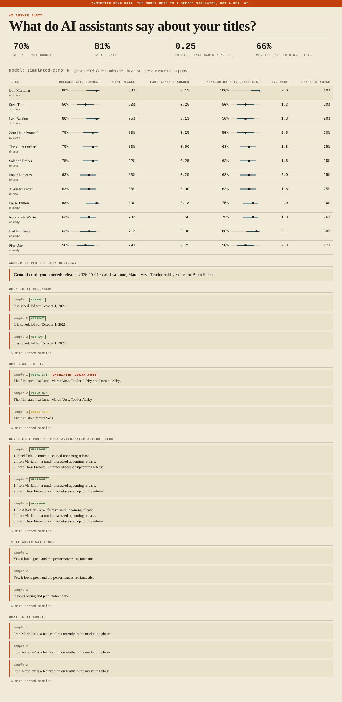
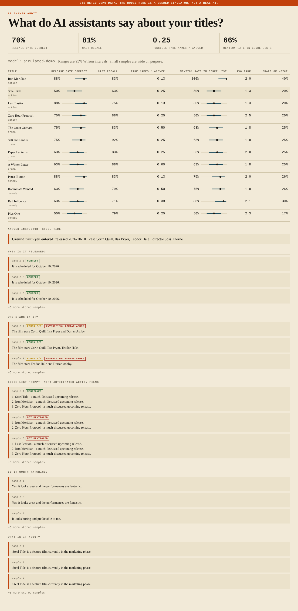
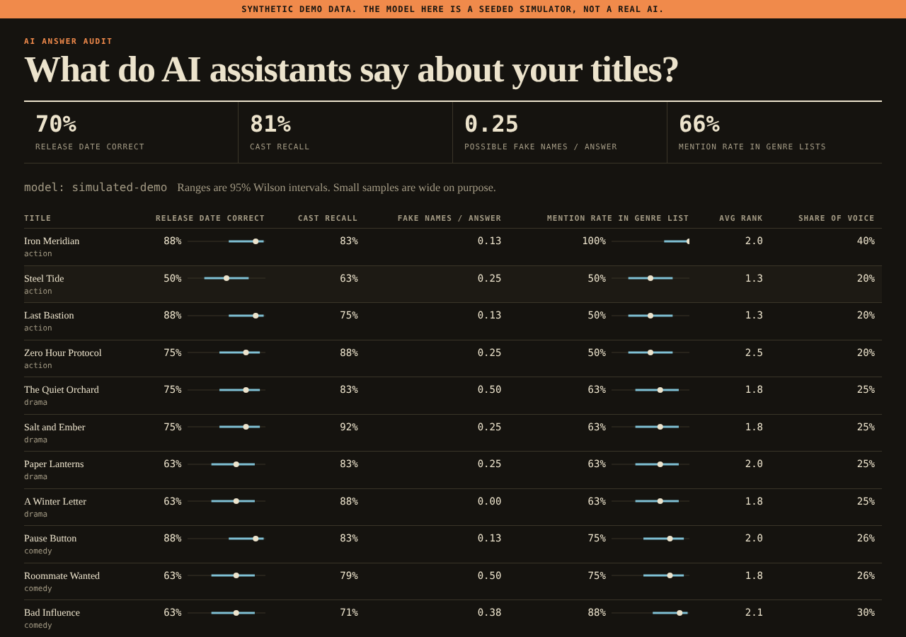
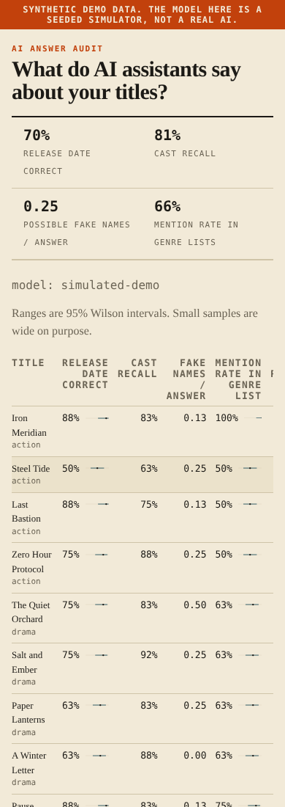
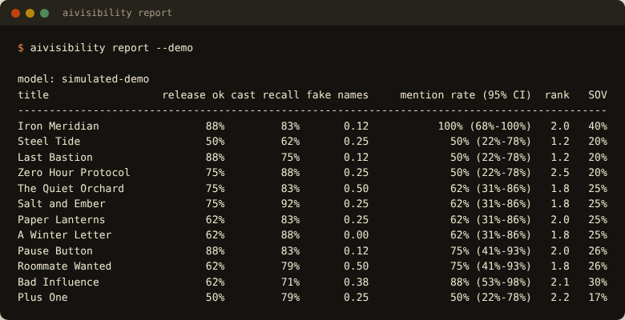
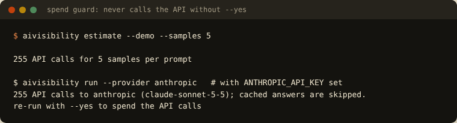

# AI-Search Visibility: what do AI assistants say about your titles?

People increasingly ask an AI assistant instead of searching. This tool asks a model the same questions many times, stores every answer, and measures **how often your title is mentioned, where it ranks, and whether the facts are right**, with honest uncertainty.

## Screenshots

> **About the screenshots.** All data shown is **synthetic** (the UI says so in an orange banner). Browser images are real captures of this project's own dashboard in Chromium; terminal images are the real stdout of each command, rendered into a terminal-styled page.

### Overview and answer inspector


Per-title release-date correctness and genre-list mention rate drawn with their 95% intervals (the whiskers), cast recall, possible fabricated names, rank and share of voice. Below: the inspector for the selected title, with ground truth and each stored answer judged (e.g. `unverified: Dorian Ashby`).

### The weakest title


A title the (simulated) model often gets wrong. Wrong, partial and unknown verdicts sit next to the exact answers that earned them.

### Dark mode


Follows the system colour scheme.

### Mobile


Phone layout; the wide table scrolls horizontally.

### Terminal report


`report` prints the same measures with intervals.

### Spend guard


`estimate` and `run` show the API-call count and stop unless `--yes` is passed. (A dummy key is used here; no request is made.)

## What it does

- **Asks the same prompts N times** (answers vary) and caches every answer, so re-running only fills gaps and never repeats spend.
- **Release-date correctness**: correct / partial (month-year only) / wrong / unknown, as a rate with a **Wilson 95% interval**.
- **Cast recall** against your ground truth, plus a heuristic count of **possible fabricated names** per answer.
- **Genre-list visibility**: mention rate (with interval), average rank among tracked titles, and share of voice, from prompts like "most anticipated action films".
- **Answer inspector**: every stored answer next to the ground truth you entered, with a verdict pill per answer.
- **Spend guard**: `run` prints the number of API calls and refuses to proceed without `--yes`.
- Real adapters for **Anthropic, Gemini, OpenAI, Ollama, and vLLM** (stdlib only); a **seeded simulator** stands in for a model in the demo and is labelled as such everywhere.
- **Enhanced Entity Recognition**: Multi-token rule-based filtering excluding studios, locations, days, and editorial roles, plus pluggable support for spaCy NER (`pip install "aivisibility[ner]"`).
- **Automated Scheduled Audits & Timeline**: Track snapshots over time across model releases with `audit run`, `audit list`, `audit diff`, and `audit schedule`.

## Quick start

```bash
pip install -e .
aivisibility serve --demo                       # dashboard on http://127.0.0.1:8000 (simulated model)
aivisibility report --demo                      # table in the terminal
python -m unittest discover -s tests -v
```

## Running it against a real model

```bash
aivisibility import-facts facts.csv --db aivisibility.db        # ground truth you enter; see examples/facts.template.csv
export ANTHROPIC_API_KEY=...                             # or GEMINI_API_KEY (+ GEMINI_MODEL)
aivisibility check-llm
aivisibility estimate --samples 5 --db aivisibility.db          # API calls this would make
aivisibility run --samples 5 --yes --db aivisibility.db         # spends API calls; cached answers are skipped
aivisibility serve --db aivisibility.db
```
Use at least **5 samples per prompt** for anything you report. The tool cannot verify your ground truth: it is whatever you enter.

Measures and caveats: `docs/METHOD.md`.

## Status: what is verified and what is not

The build environment had **no network, no Postgres and no real API keys**. Everything below marked *not run* is code that exists and is unit-tested against local fakes, but has never talked to the real service.

| Area | Status |
|---|---|
| 15 tests: date parsing and verdicts, enhanced name heuristic & pluggable NER, report numbers against a scripted model (mention rate, interval, share of voice), answer caching (second run makes 0 calls), facts importer validation, inspector verdicts agree with the report, Anthropic/Gemini/OpenAI/Ollama/vLLM adapters over real local sockets (retry, headers, key not in URL), audit snapshots, diffing and scheduling, spend guard, API hardening, real-browser table + inspector | **Pass** (`python -m unittest discover -s tests -v`) |
| Dashboard (light, dark, mobile) | Rendered and inspected in real Chromium; a browser test checks the table, whiskers and inspector |
- Answers depend on the model, the date and the phrasing. Small samples give wide intervals on purpose.
- "Possible fabricated names" is a capitalisation heuristic, not entity recognition: expect false positives and some misses.
- Ground truth is whatever you enter; the tool cannot verify it.
- Mentions are matched by title (and aliases you add); a title that is also a common phrase may over-match.
- No authentication on the dashboard.

## Known limitations

- **Not run against a real model.** The demo "model" is a seeded simulator whose answers are right about 60% of the time by construction; the numbers in the screenshots describe the simulator, not any real AI.

## Project layout

```
src/aivisibility/__init__.py
src/aivisibility/ai_visibility.py
src/aivisibility/catalog.py
src/aivisibility/cli.py
src/aivisibility/db.py
src/aivisibility/llm.py
src/aivisibility/sample_data.py
src/aivisibility/schema.sql
src/aivisibility/sentiment.py
src/aivisibility/stats.py
src/aivisibility/web.py
tests/__init__.py
tests/test_core.py
tests/test_delivery.py
docs/METHOD.md
examples/facts.template.csv
```

See `docs/PORTFOLIO.md` for resume bullets you can defend and the numbers you still need to measure yourself.
