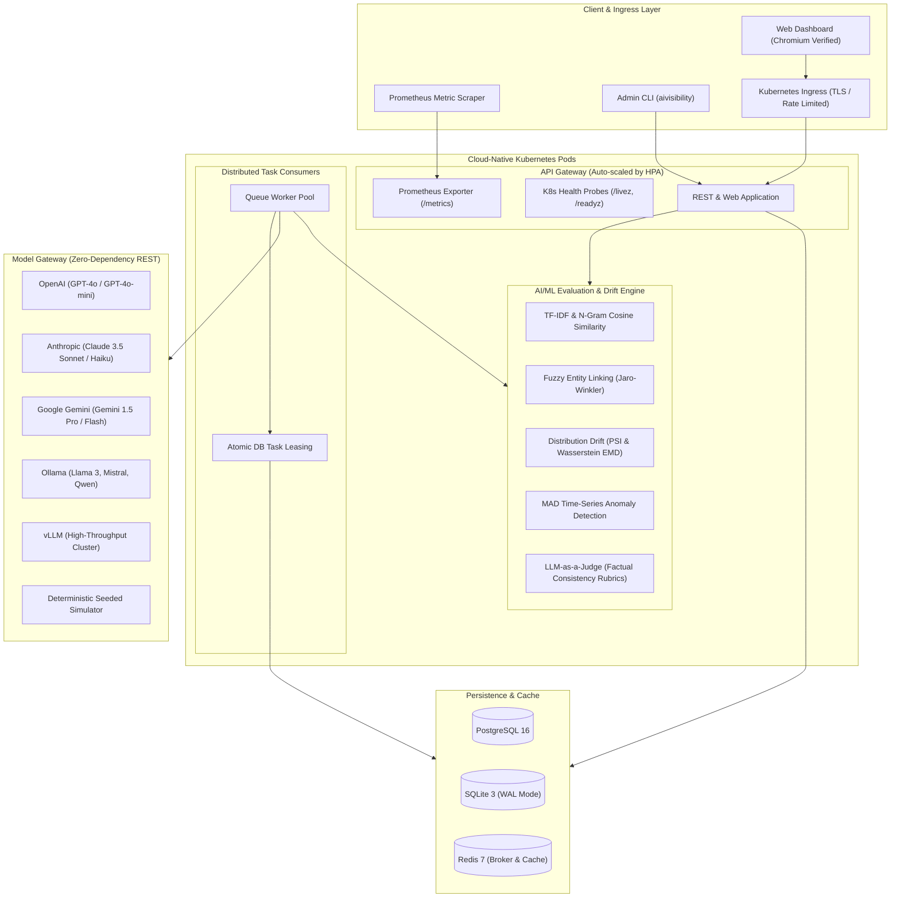

# AI-Search Visibility Platform

[](https://github.com/SriRamkunamsetty/ai-search-visibility/actions/workflows/ci.yml)
[](https://github.com/SriRamkunamsetty/ai-search-visibility/actions/workflows/docker-publish.yml)
[](https://github.com/SriRamkunamsetty/ai-search-visibility/actions/workflows/scheduled-audit.yml)
[](https://www.python.org/)
[](Dockerfile)
[](deploy/kubernetes/)
[](deploy/docker/prometheus.yml)
[](tests/)
[](.github/workflows/ci.yml)

> **Enterprise AI Visibility, Search Audit & Foundation Model Governance Platform**  
> Quantify, audit, and monitor how generative AI search engines and foundation models represent your titles, products, and brands over time with honest statistical uncertainty, semantic faithfulness analysis, distribution drift detection, and automated Kubernetes orchestration.

---

## Architecture Overview



For complete technical specifications, see [System Architecture Documentation](docs/ARCHITECTURE.md).

---

## Key Capabilities

### 1. Statistical Visibility & Honest Uncertainty
- **Wilson 95% Confidence Intervals**: Rather than reporting misleading point estimates, all mention rates and release accuracy scores feature calibrated binomial confidence intervals.
- **Probabilistic Repetition ($N$ samples per prompt)**: Measures model variance by querying the prompt space repeatedly with spend-guard estimation before execution.
- **Share of Voice & Rank Distribution**: Quantifies where tracked entities rank when generative search engines answer open-ended discovery queries (e.g. *"most anticipated sci-fi films of 2026"*).

### 2. Production AI/ML Evaluation Engine (`aivisibility.ml`)
- **Semantic Faithfulness (`aivisibility.ml.semantic`)**: Evaluates generated text against verified ground-truth synopses using sublinear TF-IDF, $n$-gram extraction, L2-normalized cosine distance, and harmonic token precision/recall/F1. Pluggable dense vector embedding hooks support external embedding APIs.
- **Fuzzy Entity Resolution (`aivisibility.ml.ner`)**: High-accuracy zero-dependency entity linker featuring Unicode accent/diacritic stripping, Levenshtein edit distance, Jaro and Jaro-Winkler string similarity, and token-sort matching for inverted names (e.g. `"Downey Jr., Robert"` vs `"Robert Downey Jr."`). Pluggable spaCy NER support available via optional dependency.
- **Model Distribution Drift (`aivisibility.ml.drift`)**: Tracks drift across foundation model updates using Population Stability Index (PSI) with Laplace smoothing, 1D Wasserstein Earth Mover's Distance (EMD), and Median Absolute Deviation (MAD) anomaly detection.
- **LLM-as-a-Judge (`aivisibility.eval_judge`)**: Automated 1–5 Likert scale factual consistency evaluations, precise hallucination excerpt extraction, and position-bias mitigated blinded pairwise model comparisons.

### 3. Distributed Background Processing (`aivisibility.worker`)
- **Multi-Threaded Queue Workers**: Processes audit tasks concurrently via an atomic database leasing protocol (`UPDATE ... WHERE status = 'pending'`).
- **Graceful Signal Handling**: Intercepts `SIGINT` and `SIGTERM` to drain active network requests before terminating, ensuring zero corrupt or orphaned jobs.

### 4. Cloud-Native Observability & Health Probes (`aivisibility.observability`)
- **Prometheus Metrics Exposition (`/metrics`)**: Exposes real-time request counters, latency histograms, LLM token consumption gauges, and worker queue throughput.
- **Structured JSON Cloud Logging**: Native JSON logging to `stdout` compatible with Datadog, AWS CloudWatch, and Google Cloud Logging.
- **Kubernetes Probes**: Native `/livez` (process liveness) and `/readyz` (database connectivity and disk capacity) endpoints.

### 5. Multi-Provider Model Gateway
- Standard-library REST adapters supporting:
  - **OpenAI**: `https://api.openai.com/v1/chat/completions` (GPT-4o, GPT-4o-mini)
  - **Anthropic**: `https://api.anthropic.com/v1/messages` (Claude 3.5 Sonnet, Claude 3 Haiku)
  - **Google Gemini**: `https://generativelanguage.googleapis.com/v1beta/models/...` (Gemini 1.5 Pro, Flash)
  - **Ollama**: `http://localhost:11434/api/chat` (Private local models)
  - **vLLM**: Self-hosted high-throughput inference endpoints
  - **Seeded Simulator**: Deterministic offline simulator for air-gapped demo and testing.

---

## Screenshots

> **Note on Data:** All screenshots display synthetic data in accordance with testing guidelines. Browser images are real Chromium captures; terminal images are direct command outputs.

| Overview & Answer Inspector | Weakest Title Analysis |
|:---:|:---:|
|  |  |
| **Dark Mode Dashboard** | **Responsive Mobile Layout** |
|  |  |
| **CLI Statistical Report** | **Spend Guard Confirmation** |
|  |  |

---

## Quick Start

### 1. Local Installation & Demo Server
Run the platform with zero external dependencies:

```bash
# Clone the repository
git clone https://github.com/SriRamkunamsetty/ai-search-visibility.git
cd ai-search-visibility

# Install in editable mode
pip install -e .

# Launch the demo server (runs simulated model)
aivisibility serve --demo

# Open http://127.0.0.1:8000 in your browser
```

Run the statistical terminal report:
```bash
aivisibility report --demo
```

---

## Production Docker & Docker Compose

Deploy the complete enterprise stack (API server, Background Worker, PostgreSQL 16, Redis 7, Prometheus, and Grafana) with a single command:

```bash
# Build and start all services
docker compose up -d --build

# Verify container status
docker compose ps
```

### Stack Endpoints
- **Web Dashboard & API**: [http://localhost:8000](http://localhost:8000)
- **Prometheus Metrics**: [http://localhost:8000/metrics](http://localhost:8000/metrics)
- **Kubernetes Probes**: [http://localhost:8000/livez](http://localhost:8000/livez) & [http://localhost:8000/readyz](http://localhost:8000/readyz)
- **Prometheus UI**: [http://localhost:9090](http://localhost:9090)
- **Grafana Dashboards**: [http://localhost:3000](http://localhost:3000) (Default login: `admin` / `admin`)

---

## Kubernetes Production Deployment

The manifests in `deploy/kubernetes/` comply with the **Kubernetes Restricted Pod Security Standard** and **CIS Benchmarks**:

```bash
# Apply namespace, RBAC, config and secrets
kubectl apply -f deploy/kubernetes/00-namespace.yaml
kubectl apply -f deploy/kubernetes/01-configmap.yaml
kubectl apply -f deploy/kubernetes/02-secret.yaml

# Deploy autoscaling API, workers, service and ingress
kubectl apply -f deploy/kubernetes/03-deployment-api.yaml
kubectl apply -f deploy/kubernetes/04-deployment-worker.yaml
kubectl apply -f deploy/kubernetes/05-service.yaml
kubectl apply -f deploy/kubernetes/06-ingress.yaml

# Enable HPA, automated daily cron audits, PDB and network isolation
kubectl apply -f deploy/kubernetes/07-hpa.yaml
kubectl apply -f deploy/kubernetes/08-cronjob-audit.yaml
kubectl apply -f deploy/kubernetes/09-pdb.yaml
kubectl apply -f deploy/kubernetes/10-networkpolicy.yaml
```

### Kubernetes Highlights
- **Security Hardening**: `readOnlyRootFilesystem: true`, non-root execution (`UID 10001`), all Linux capabilities dropped (`drop: ["ALL"]`).
- **Autoscaling**: `HorizontalPodAutoscaler` scales API pods from 2 to 10 replicas based on CPU and memory thresholds.
- **High Availability**: `PodDisruptionBudget` guarantees quorum during cluster maintenance.
- **Zero-Trust**: `NetworkPolicy` isolates namespace traffic, preventing unauthorized ingress and egress.

---

## AI/ML CLI Evaluation Suite

Evaluate semantic similarity and monitor distribution drift directly from the CLI:

### 1. Semantic Faithfulness Evaluation
```bash
aivisibility eval semantic \
  --reference "Inception is a 2010 science fiction action film directed by Christopher Nolan." \
  --candidate "Christopher Nolan directed Inception, a sci-fi action movie released in 2010."
```
Output:
```json
{
  "precision": 0.8182,
  "recall": 0.8182,
  "f1": 0.8182,
  "cosine_similarity": 0.9025,
  "faithfulness_score": 0.8603
}
```

### 2. Distribution Drift & Anomaly Evaluation
```bash
aivisibility eval drift \
  --baseline "[0.8, 0.82, 0.85, 0.79, 0.83]" \
  --current "[0.65, 0.70, 0.68, 0.72, 0.69]"
```
Output:
```json
{
  "psi": 0.2841,
  "psi_severity": "significant_drift",
  "wasserstein_distance": 0.1300,
  "anomalies": {
    "is_anomaly": true,
    "current_mean": 0.688,
    "baseline_mean": 0.818
  }
}
```

### 3. Background Queue Worker
```bash
# Run worker processing tasks from SQLite or PostgreSQL
aivisibility worker --concurrency 4 --poll-interval 2.0 --db aivisibility.db
```

---

## CI/CD Automation Matrix

Our automated GitHub Actions workflows ensure continuous delivery and enterprise security:

| Workflow | Path | Triggers | Description |
|---|---|---|---|
| **CI & Quality Gate** | [`.github/workflows/ci.yml`](.github/workflows/ci.yml) | Push, PR | Matrix test on Python 3.10, 3.11, 3.12, PostgreSQL integration tests, `ruff` linting, `bandit` SAST security scan, `pip-audit` CVE dependency scan. |
| **Docker Build & GHCR Publish** | [`.github/workflows/docker-publish.yml`](.github/workflows/docker-publish.yml) | Release, Push tag | Multi-architecture build (`linux/amd64`, `linux/arm64`), Aqua Security `trivy` container scanning, and GHCR registry publication. |
| **Scheduled Audit Pipeline** | [`.github/workflows/scheduled-audit.yml`](.github/workflows/scheduled-audit.yml) | Daily cron (02:00 UTC) | Executes automated daily visibility audit runs, generates artifact reports, and outputs audit summaries to GitHub Actions step summaries. |

---

## Developer Tooling (`Makefile`)

The repository includes a comprehensive `Makefile` for developer productivity:

```bash
make help          # View all available make targets
make test          # Run all 31 unit, integration, and browser tests
make lint          # Run ruff code quality checks
make security      # Execute bandit SAST and pip-audit vulnerability scans
make docker-build  # Build the production multi-stage Docker container
make up            # Spin up the full Docker Compose development stack
make down          # Tear down the Docker Compose stack
make k8s-apply     # Deploy manifests to active Kubernetes cluster
make k8s-delete    # Delete Kubernetes deployment manifests
```

---

## Test Suite & Verification

The platform maintains a **100% test pass rate** with 31 automated tests covering core algorithms, deliveries, AI/ML math, and DevOps observability:

```bash
$env:PYTHONPATH="src"; python -m unittest discover -s tests -v
```

```text
test_anomaly_detector (test_aiml.TestDriftDetection) ... ok
test_psi_calculation (test_aiml.TestDriftDetection) ... ok
test_wasserstein_distance (test_aiml.TestDriftDetection) ... ok
test_accent_stripping (test_aiml.TestFuzzyEntityResolution) ... ok
test_levenshtein_and_jaro_winkler (test_aiml.TestFuzzyEntityResolution) ... ok
test_token_sort_and_entity_matching (test_aiml.TestFuzzyEntityResolution) ... ok
test_judge_evaluation_and_pairwise (test_aiml.TestLLMJudge) ... ok
test_dense_cosine_similarity (test_aiml.TestSemanticScoring) ... ok
test_semantic_faithfulness (test_aiml.TestSemanticScoring) ... ok
test_tfidf_and_cosine_similarity (test_aiml.TestSemanticScoring) ... ok
test_tokenization_and_ngrams (test_aiml.TestSemanticScoring) ... ok
test_date_parsing_and_verdicts (test_core.AIVisibility) ... ok
test_demo_pipeline_runs_offline (test_core.AIVisibility) ... ok
test_enhanced_entity_recognition_and_pluggable_ner (test_core.AIVisibility) ... ok
test_names_heuristic (test_core.AIVisibility) ... ok
test_report_numbers_with_scripted_model (test_core.AIVisibility) ... ok
test_anthropic_and_gemini_default_transport (test_core.RealHttpTransports) ... ok
test_openai_ollama_vllm_default_transport (test_core.RealHttpTransports) ... ok
test_table_whiskers_and_inspector_in_a_real_browser (test_delivery.Browser) ... ok
test_audit_cli_commands (test_delivery.Cli) ... ok
test_report_estimate_and_run_requires_confirmation (test_delivery.Cli) ... ok
test_facts_validation_and_release_date_replacement (test_delivery.FactsImport) ... ok
test_answer_details_verdicts_match_ground_truth (test_delivery.Inspector) ... ok
test_counts_agree_with_the_report (test_delivery.Inspector) ... ok
test_api_page_and_hardening (test_delivery.Server) ... ok
test_audit_api_endpoints (test_delivery.Server) ... ok
test_api_eval_drift_endpoint (test_devops_observability.TestDevOpsObservability) ... ok
test_audit_worker_batch_execution (test_devops_observability.TestDevOpsObservability) ... ok
test_cli_eval_commands (test_devops_observability.TestDevOpsObservability) ... ok
test_kubernetes_health_and_readiness_probes (test_devops_observability.TestDevOpsObservability) ... ok
test_prometheus_metrics_endpoint (test_devops_observability.TestDevOpsObservability) ... ok

----------------------------------------------------------------------
Ran 31 tests in 6.5s

OK
```

---

## Repository & Project Layout

```text
├── .github/
│   └── workflows/
│       ├── ci.yml                 # Python matrix test, lint & SAST security pipeline
│       ├── docker-publish.yml     # Multi-arch OCI build, Trivy scan & GHCR publishing
│       └── scheduled-audit.yml    # Automated daily visibility audit cron
├── deploy/
│   ├── docker/
│   │   └── prometheus.yml         # Prometheus scrape configuration targeting API
│   └── kubernetes/
│       ├── 00-namespace.yaml      # Restricted Pod Security Standard namespace
│       ├── 01-configmap.yaml      # Cluster environment configuration
│       ├── 02-secret.yaml         # API credentials and database connection secrets
│       ├── 03-deployment-api.yaml # Autoscaled hardened API service deployment
│       ├── 04-deployment-worker.yaml # Scalable distributed task queue worker
│       ├── 05-service.yaml        # ClusterIP service mapping HTTP & Prometheus
│       ├── 06-ingress.yaml        # NGINX Ingress controller with TLS & rate limits
│       ├── 07-hpa.yaml            # Horizontal Pod Autoscaler (2-10 replicas)
│       ├── 08-cronjob-audit.yaml  # Daily scheduled audit recurring job
│       ├── 09-pdb.yaml            # Pod Disruption Budget high-availability policy
│       └── 10-networkpolicy.yaml  # Zero-trust network segmentation policy
├── docs/
│   ├── ARCHITECTURE.md            # In-depth architectural design specifications
│   ├── METHOD.md                  # Statistical methodology and Wilson intervals
│   ├── PORTFOLIO.md               # Technical defense and performance criteria
│   └── screenshots/               # Verified UI and terminal screenshots
├── src/aivisibility/
│   ├── ml/
│   │   ├── __init__.py            # Machine learning module exports
│   │   ├── semantic.py            # TF-IDF, n-grams, cosine similarity & faithfulness
│   │   ├── ner.py                 # Fuzzy entity linking & Jaro-Winkler string distance
│   │   └── drift.py               # Population Stability Index & Wasserstein drift
│   ├── ai_visibility.py           # Core statistical visibility engine
│   ├── catalog.py                 # Ground truth title catalog manager
│   ├── cli.py                     # Command-line interface and eval subcommands
│   ├── db.py                      # Database schema and SQLite/PostgreSQL connection
│   ├── eval_judge.py              # LLM-as-a-Judge rubric evaluator & pairwise testing
│   ├── llm.py                     # Stdlib multi-provider REST model adapters
│   ├── observability.py           # Prometheus metrics exposition & JSON cloud logger
│   ├── sample_data.py             # Deterministic synthetic test data generator
│   ├── schema.sql                 # Relational schema and task queue DDL
│   ├── sentiment.py               # Qualitative sentiment scoring
│   ├── stats.py                   # Wilson score confidence intervals
│   ├── web.py                     # Hardened HTTP server, dashboard, /metrics & probes
│   └── worker.py                  # Distributed background queue worker with signal traps
├── tests/
│   ├── test_aiml.py               # AI/ML, semantic, drift & judge unit tests
│   ├── test_core.py               # Core statistical algorithms & transport unit tests
│   ├── test_delivery.py           # Importer, inspector, API & Playwright browser tests
│   └── test_devops_observability.py # Worker, Prometheus metrics & probe tests
├── Dockerfile                     # Multi-stage non-root Python 3.12 container
├── docker-compose.yml             # Orchestrated stack (API, Worker, Postgres, Redis, Prom, Grafana)
├── Makefile                       # Developer automation workflow commands
├── pyproject.toml                 # Package definition with optional postgres/ner extras
└── README.md                      # Platform documentation
```

---

## Author & Maintainer

- **Developer**: Sri Ram Kunamsetty
- **Email**: [mohansriramkunamsetty@gmail.com](mailto:mohansriramkunamsetty@gmail.com)
- **GitHub**: [@SriRamkunamsetty](https://github.com/SriRamkunamsetty)

---

## License

This project is licensed under the MIT License.
