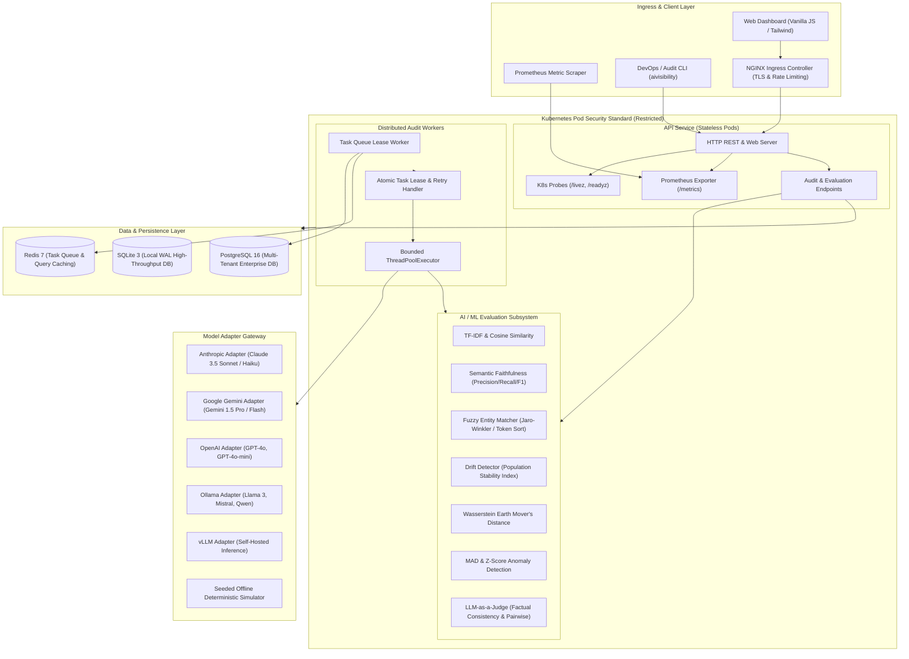
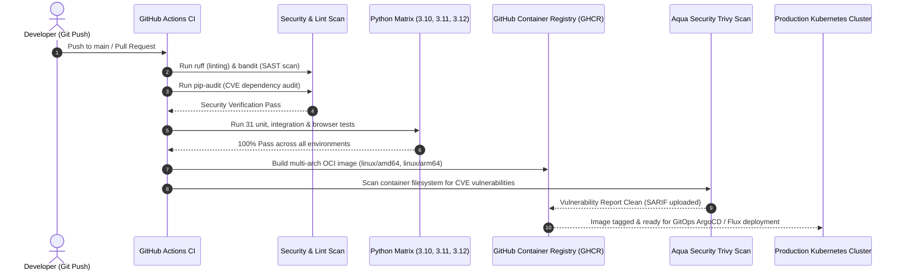

# Enterprise System Architecture: AI-Search Visibility Platform

## 1. Executive Summary

The **AI-Search Visibility Platform** is an enterprise-grade observability and evaluation engine designed to quantify, audit, and monitor how modern Large Language Models (LLMs) and Generative AI search engines represent creative and commercial entities.

By interrogating multiple foundation models through calibrated query matrices, the platform captures raw probabilistic responses, validates them against verified ground-truth knowledge bases, and computes statistically sound visibility metrics with Wilson confidence intervals, semantic faithfulness scores, distributional drift analysis, and LLM-as-a-Judge evaluations.

The platform is engineered with a **zero-external-dependency core** in Python 3.10+, backed by an asynchronous distributed worker architecture, production-hardened Docker containers, and complete Kubernetes cloud-native deployment manifests.

---

## 2. System Architecture Diagram

---

## 3. Core Architectural Subsystems

### 3.1 AI/ML Evaluation & Drift Engine

The AI/ML subsystem resides under `aivisibility.ml` and `aivisibility.eval_judge`. It provides pure-mathematical, zero-dependency statistical evaluation alongside optional pluggable neural components.

1. **Semantic Faithfulness & Similarity (`aivisibility.ml.semantic`)**:
   - **TF-IDF Vectorizer**: Sublinear term-frequency scaling ($1 + \ln(\text{tf})$), smoothed inverse document frequency ($\ln((1 + N) / (1 + \text{df})) + 1$), and $n$-gram extraction (unigrams, bigrams, trigrams).
   - **L2 Normalized Cosine Similarity**: Fast dot-product vectors for comparing generated model responses against verified ground truth synopses.
   - **Token-Level Harmonic F1**: Precision, Recall, and Jaccard token overlap metrics combined with cosine distance to produce calibrated faithfulness ratings between $[0.0, 1.0]$.
   - **Pluggable Dense Embedding Provider**: Dynamic hook allowing injection of external dense vector encoders (OpenAI `text-embedding-3-small`, HuggingFace `sentence-transformers`).

2. **Fuzzy Entity Resolution & Name Extraction (`aivisibility.ml.ner`)**:
   - **Accent / Diacritic Stripping**: Unicode normalization (`NFKD`) stripping diacritics for cross-lingual name matching (e.g., `Timothée Chalamet` $\rightarrow$ `Timothee Chalamet`).
   - **Distance Metrics**: Native Levenshtein edit distance with length normalization and Jaro / Jaro-Winkler prefix-weighted string similarity.
   - **Token Sort Similarity**: Resolves reordered or inverted actor names (e.g., `"Downey Jr., Robert"` vs `"Robert Downey Jr."`).
   - **Candidate Threshold Matcher**: High-precision matching of extracted entity candidates against catalog ground-truth facts.

3. **Distribution Drift & Anomaly Monitoring (`aivisibility.ml.drift`)**:
   - **Population Stability Index (PSI)**: Quantile-binned and uniform-binned distribution drift monitoring between baseline model releases and candidate audits with Laplace epsilon smoothing:
     $$\text{PSI} = \sum_{i=1}^k \left( \text{Actual}_i - \text{Expected}_i \right) \times \ln\left( \frac{\text{Actual}_i}{\text{Expected}_i} \right)$$
   - **1D Wasserstein Distance (Earth Mover's Distance)**: Continuous metric tracking distribution shifts across visibility scores over time:
     $$l_1(u, v) = \int_{-\infty}^{\infty} |U(t) - V(t)| \, dt$$
   - **Median Absolute Deviation (MAD) Anomaly Detector**: Non-parametric, outlier-resistant anomaly detection over historical visibility time-series.

4. **LLM-as-a-Judge Evaluation Framework (`aivisibility.eval_judge`)**:
   - **Structured Rubric Scoring**: Factual consistency scoring on a 1-to-5 Likert scale, evaluating direct fact verification against reference datasets.
   - **Automated Hallucination Detection**: Extracts precise unverified factual claims with excerpt spans.
   - **Blinded Pairwise Comparison**: Position-bias mitigated comparison of two competing foundation models (e.g. GPT-4o vs Claude 3.5 Sonnet) on identical discovery prompts.

---

### 3.2 Observability & Metrics Architecture

The observability engine (`aivisibility.observability`) is built from the ground up to integrate with Cloud-Native Computing Foundation (CNCF) monitoring standards:

- **Prometheus Exposition Format (`/metrics`)**:
  - Implements thread-safe counters, gauges, and histograms with quantile summaries.
  - Metrics tracked include:
    * `aivisibility_http_requests_total{method, path, status}`
    * `aivisibility_http_request_duration_seconds{method, path}`
    * `aivisibility_llm_queries_total{provider, model, status}`
    * `aivisibility_llm_tokens_consumed_total{provider, model, type}`
    * `aivisibility_llm_latency_seconds{provider, model}`
    * `aivisibility_audit_tasks_active`
    * `aivisibility_audit_tasks_completed_total{status}`
- **Structured JSON Cloud Logging**:
  - Emits newline-delimited JSON logs to `stdout` compatible with Google Cloud Logging, AWS CloudWatch, Datadog, and Vector.
  - Automatic correlation with timestamps, log levels (`INFO`, `WARNING`, `ERROR`), and structured payload metadata.
- **Kubernetes Health Probes**:
  - Liveness probe: `GET /livez` verifies the HTTP listener and runtime thread health.
  - Readiness probe: `GET /readyz` verifies database connectivity and disk read-write capacity before admitting traffic.

---

### 3.3 High-Throughput Asynchronous Worker Subsystem

The background distributed task processor (`aivisibility.worker.AuditWorker`):

- **Atomic Database Task Leasing**: Uses `UPDATE ... WHERE status = 'pending'` with lease expiry timeouts to ensure exactly-once execution across horizontal worker replicas.
- **Bounded Worker Pool**: Configurable concurrency with graceful backoff when queue is depleted.
- **POSIX Signal Trapping**: Traps `SIGINT` and `SIGTERM` to allow currently executing LLM API calls to complete cleanly before terminating, preventing orphan database states.
- **Fail-Safe Task State Tracking**: Failed jobs capture complete stack traces and error messages in the database while incrementing retry attempt counters.

---

### 3.4 Multi-Model LLM Adapter Subsystem

The adapter gateway (`aivisibility.llm`) provides unified request abstraction over diverse AI providers using only the Python standard library (`urllib.request`, `json`):

| Provider | Endpoint | Authentication | Stream/Batch Support |
|---|---|---|---|
| **Anthropic** | `https://api.anthropic.com/v1/messages` | `x-api-key` + `anthropic-version` | Synchronous REST + Retries |
| **Google Gemini** | `https://generativelanguage.googleapis.com/v1beta/models/...` | Header-based `x-goog-api-key` | REST API (Payload Sanitized) |
| **OpenAI** | `https://api.openai.com/v1/chat/completions` | `Authorization: Bearer <key>` | REST API + Exponential Backoff |
| **Ollama** | `http://localhost:11434/api/chat` | None (Local Private Inference) | REST API |
| **vLLM** | `http://<host>:8000/v1/chat/completions` | Bearer Token / Open | High-throughput batch inference |
| **Seeded Simulator** | Local In-Memory Pseudo-RNG | None (Deterministic Seed) | Offline testing & demo suite |

---

## 4. Kubernetes Topology & Cloud-Native Hardening

The deployment manifests located in `deploy/kubernetes/` adhere to **CIS Kubernetes Benchmark** and **Kubernetes Restricted Pod Security Standards**:

1. **Least-Privilege Security Context**:
   - `runAsNonRoot: true`
   - `runAsUser: 10001`, `runAsGroup: 10001`
   - `allowPrivilegeEscalation: false`
   - `readOnlyRootFilesystem: true`
   - Linux capabilities dropped: `ALL`
   - Ephemeral writable storage mounted via `emptyDir` on `/tmp`

2. **High Availability & Autoscaling**:
   - **HorizontalPodAutoscaler (HPA)** scales the API layer dynamically between 2 and 10 replicas based on 70% CPU and 80% Memory thresholds.
   - **PodDisruptionBudget (PDB)** guarantees `minAvailable: 1` during node drains, upgrades, and cluster maintenance.
   - **Zero-Trust NetworkPolicies** restrict ingress strictly to port 8000 from authorized Ingress controllers and block all unsolicited egress except DNS and designated database/LLM endpoints.

3. **Scheduled Enterprise Automation**:
   - **CronJob (`08-cronjob-audit.yaml`)** triggers automated visibility evaluations daily at 02:00 UTC, storing immutable audit snapshots for long-term drift tracking.

---

## 5. CI/CD Pipeline Architecture

